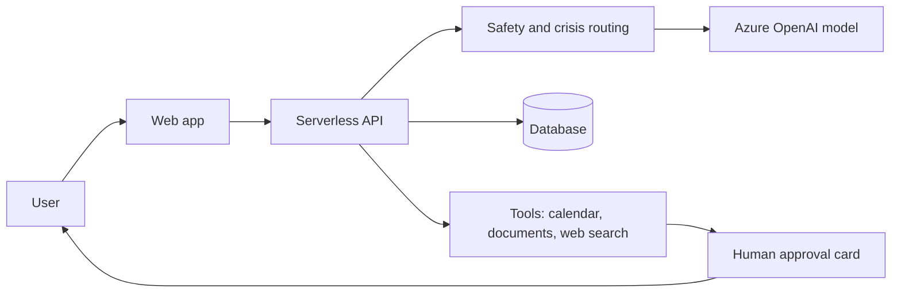

# Babs: How I'm Building an AI Assistant Without Writing Code

*By Michael Sagoe, Founder, Padagoe Labs. Last updated October 2026.*

## The short version

I'm not a developer, and I don't write code. I'm the product owner of Babs, an AI assistant that works with your calendar, email, documents and reminders. I decide what gets built, what it costs and when it's good enough to ship. AI does the building: one AI helps me plan and review the work, and a coding agent writes it. I direct both, and I check their work myself.

| | |
|---|---|
| **Product** | Babs, an AI personal assistant |
| **My role** | Product owner and AI delivery lead |
| **Built with** | Azure OpenAI, a serverless back end, a managed database and a web app |
| **Status** | Private beta, moving toward a capped public beta |

## Why I'm building it

Most AI chatbots sit there until you ask them something. I wanted an assistant that keeps track of what you've committed to, helps you act on it, and speaks up when something matters. It also has to be safe and affordable. An assistant that burns through cloud money isn't a business.

## How it fits together

## Three decisions that show how I work

### 1. I dropped the second AI provider
Babs started with two AI providers, one as a backup for the other. That sounded smart, but it added cost and complexity, and I wanted to know if it was earning its keep.

So I pulled about 11 weeks of real production data. There were no real outages on the main provider. Thirty of the backup provider's own calls failed because its credits ran out. Thirteen of the 15 times Babs fell back to the second provider were because Azure's content filter blocked a reply, not because anything was down. My AI architect had also told me the failover only ran in one direction, and the data showed it ran both ways. I went with the data.

I dropped the second provider from the live path and kept the code behind a switch in case I need it back. I also fixed the real gaps: a retry when the server hiccups, and a friendlier message when the content filter blocks a reply.

### 2. A cloud bill I didn't plan for
One month's Azure bill came in far above what I planned. I froze development and tracked down why. Automated tests were calling live AI models every time code was pushed, and some deployments were running more than once.

After that I wrote the rules into the project itself so every build session follows them. Tests use mocks first. Live AI calls are capped per change. There's one deploy per batch of work. Every build report ends with a spend summary. The biggest leak, live-model tests firing on every push, is closed, and I'm watching the next full billing cycle to confirm it.

The lesson is that cost controls belong in the design before you automate anything, not after the bill arrives.

### 3. I'm matching the model to the job
Right now one premium model handles about 20 different jobs in Babs, including trivial ones like ranking a list. That's expensive for no reason.

I had every place Babs calls an AI model audited and mapped. Now I'm comparing options using Azure's benchmarks and cost data. The plan is to test cheaper models on the light jobs only, with a budget I approve first, and keep the strongest model for chat, safety and document editing. That work is still in progress.

## Safety comes first
- Crisis detection runs outside the AI model, so safety doesn't depend on the model's judgment alone.
- Babs is told to base what it says about you on real data and not make things up.
- Babs can't change your calendar without you approving it first.
- Next up is formal testing against prompt injection, plus Azure's content safety tools.

## How I manage the build
- **Audit before building.** Before any feature, I have the code checked to see what it touches.
- **Small batches.** One request at a time, one merge per batch, and versioned releases with change logs.
- **I verify everything.** I check the coding agent's reports against the database and the code. More than once it told me everything was verified when it wasn't.
- **Test it on something real.** I tested document editing on my own resume, not just sample files. That caught bugs the sample files missed, and I didn't ship until it worked. It either all works or it doesn't ship. I don't do half-baked.

## What I'd do differently
- Set cloud budget alerts and keep test and production AI separate from day one.
- Put cost guardrails in before automating tests.
- Audit which model does which job earlier, before adding more features to the same expensive one.

## What's next
A capped beta, then mail connections, billing and voice output.

## Skills this shows
AI product ownership, Azure AI planning, model selection and cost control, responsible AI, testing and verification, release management, and leading AI-assisted engineering. I'm currently preparing for Microsoft AI-103.

## Contact
[LinkedIn](https://www.linkedin.com/in/michaelsagoe/) | [mnqsagoe@gmail.com](mailto:mnqsagoe@gmail.com)
